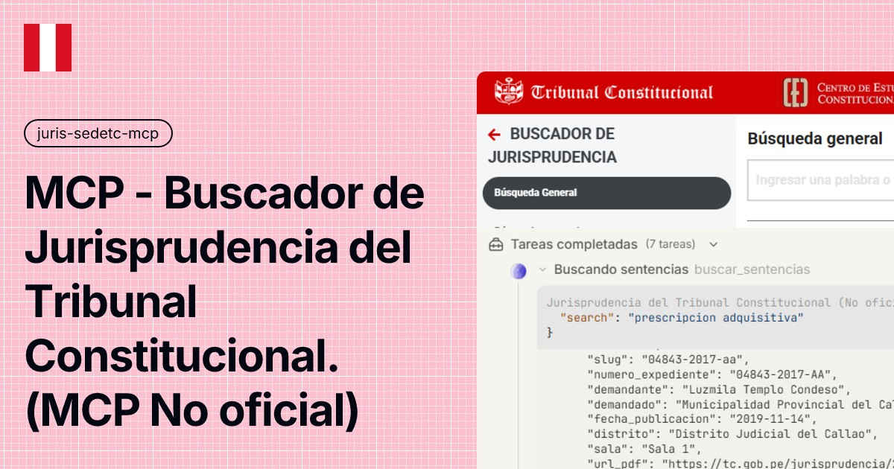

# Buscador de Jurisprudencia del Tribunal Constitucional (Conector MCP - No Oficial)




Servidor MCP **local** para buscar y leer la **jurisprudencia del Tribunal Constitucional del Perú** —la sistematización jurisprudencial del TC— desde tu harness MCP. Conexión directa con httpx: **sin navegador, sin playwright y sin credenciales**.

La vista es **única**: cada búsqueda consulta los **dos inventarios del TC** (la sistematización actual, con tesauro y buscador avanzado, hasta 2026, y el inventario histórico de resoluciones 2001-2018 con su motor propio) y entrega los resultados **fusionados con deduplicación**, como si fuera una sola fuente. El agente no necesita saber que existen dos motores: el servidor traduce, combina y declara todo en `nota`.

> Herramienta **no oficial**: sin afiliación con el Tribunal Constitucional del Perú ni con ninguna entidad del Estado peruano. Ver [Aviso legal](#aviso-legal).

| | |
|---|---|
| Fuente de datos | [jurisprudencia.sedetc.gob.pe](https://jurisprudencia.sedetc.gob.pe/sistematizacion-jurisprudencial/busqueda) (sistematización actual) + inventario histórico de resoluciones del propio TC (2001-2018) |
| Autenticación | Ninguna: todo es público |
| Almacenamiento | **Ninguno** — el servidor nunca guarda archivos: cada fila trae la URL pública del PDF (resuelta también para el inventario histórico) |
| Transporte | stdio (Claude Desktop, Claude Code, agentes compatibles con MCP) |
| Herramientas | 9 |

## Corpus (medido el 16/10/2026)

| Métrica | Valor |
|---|---|
| Sistematización actual | 74 854 resoluciones sistematizadas (buscador avanzado) o **≥10 000** por texto (cap del índice Elasticsearch), con sentidos (417), distritos (115), salas (5), tipos (224) y palabras claves (29 603) |
| Inventario histórico de resoluciones | ~88 000 resoluciones 2001-2018 (incluye Aclaraciones, Admisibilidades y de Inconstitucionalidad antiguas que la sistematización no indexa) |
| Cobertura combinada | ~163 000 documentos deduplicados en una sola vista |

## Instalación

### Opción A — Un click (sin terminal)

1. Descarga **`juris-sedetc-mcp.mcpb`** desde [Releases](https://github.com/pipaacebedo/juris-sedetc-mcp/releases/latest) (asset con nombre fijo: siempre es el mismo archivo, actualizado a la última versión).
2. Abre Claude Desktop → **Ajustes → Extensiones → Instalar desde archivo**.
3. Selecciona el `.mcpb` y listo.

> No requiere Python instalado: el instalador resuelve el runtime y las dependencias automáticamente (runtime UV de MCPB).

### Opción B — Manual (CLI y otros agentes)

Primero instala [uv](https://docs.astral.sh/uv/) si no lo tienes:

```powershell
# Windows (PowerShell)
irm https://astral.sh/uv/install.ps1 | iex
```

```bash
# macOS / Linux
curl -LsSf https://astral.sh/uv/install.sh | sh
```

Luego, en la carpeta del proyecto:

```bash
uv sync
```

Y añade a la configuración de servidores MCP de tu agente:

```json
{
  "mcpServers": {
    "juris-sedetc-mcp": {
      "command": "uv",
      "args": ["run", "--directory", "{ruta}/juris-sedetc-mcp-oss", "server.py"]
    }
  }
}
```

> Reemplaza `{ruta}` por la carpeta local donde dejaste el proyecto (ej. `C:/mcp` en Windows o `/opt/mcp` en Linux/macOS).

El servidor envía sus instrucciones de uso por el handshake MCP: el agente sabe cómo buscar y leer sin prompts adicionales.

## Actualizaciones

- El servidor se auto-chequea en cada arranque: si publicamos una versión más nueva que la tuya, tu agente verá el aviso `UPDATE DISPONIBLE` y te pedirá descargar `juris-sedetc-mcp.mcpb` de [Releases](https://github.com/pipaacebedo/juris-sedetc-mcp/releases/latest) e instalarlo de nuevo (arrástralo como la primera vez). Se desactiva con `TCJ_UPDATE_CHECK=0`.
- Cada versión reemplaza el mismo archivo (`juris-sedetc-mcp.mcpb`): la página de Releases siempre muestra una sola tarjeta con la última.

## Tools

| Tool | Qué hace |
|---|---|
| `buscar_sentencias` | Texto COMPLETO en los DOS inventarios (fusionados con dedup): normaliza tildes, comodín `*`, semántica `modo` ('todas'/'algunas'/'frase'). Cap 1000 páginas |
| `busqueda_avanzada` | Filtros EXACTOS: expediente, demandante/demandado, fecha exacta o RANGO, sentido, distrito, sala, tipo, palabras (ids) y `proceso` (del inventario histórico). Paginación profunda en la sistematización (>1000 páginas) |
| `resultados_sistematizacion` | Resultados por sistematización temática (6 ramas: precedentes vinculantes, tipos de proceso...) con texto/expediente adicionales |
| `resultados_tesauro` | Resultados por concepto del TESAURO del TC (`sentencias`/`autos`/`interlocutorias`) con ids del árbol |
| `detalle_sentencia` | Ficha completísima por slug: metadatos, tesaurio y fundamentos COMPLETOS (nunca truncados) + `url_archivo` (PDF) |
| `listar_filtros` | Catálogos exactos: tipos (224), distritos (115), salas (5), sentidos (417), tipos de tesaurio (3) y `procesos` (7 del histórico) |
| `listar_tesauro` | Árboles del tesauro NAVEGABLES (raíces + `parent_id`/`depth`, con `count_subarbol` por nodo) |
| `listar_sistematizaciones` | Árbol completo de la sistematización (6 ramas con children) |
| `listar_palabras` | Catálogo de 29 603 palabras claves con filtro local letra/contiene (alimenta `busqueda_avanzada(palabras=)`) |

## Cómo se busca (3 niveles)

1. **Descubrir** — `buscar_sentencias(search='...')` para texto completo (multi-inventario) o `busqueda_avanzada(...)` con filtros exactos; `resultados_sistematizacion(ids)` y `resultados_tesauro(ids, tipo)` para los recorridos temáticos. Filas con `index` GLOBAL 0-based continuo entre páginas y `url_pdf` en cada fila.
2. **Detalle** — `detalle_sentencia(slug)` para la ficha completa: expediente, sentencias, sentidos, tesauro y los FUNDAMENTOS COMPLETOS (la decisión, nunca truncada).
3. **Documentos** — cada fila y ficha trae la `url_pdf` (URL pública del PDF del TC): descárgalo con la tool de fetch/descarga de tu agente. Los PDFs son públicos y directos; el servidor nunca guarda archivos.

Los valores EXACTOS de los filtros salen de `listar_filtros`, `listar_tesauro`, `listar_sistematizaciones` y `listar_palabras`: no hay que adivinarlos.

## Semántica del merge (lo que el agente ve como una sola fuente)

- **`total`** = suma de ambos inventarios (cota superior); los documentos repetidos en ambos se OMITEN de las filas y el conteo va en `nota`.
- **`paginas`** = máximo de ambos; el inventario histórico se agota en la página 1000 de su motor (desde ahí el bloque trae solo sistematización y lo declara la `nota`); en `busqueda_avanzada` la sistematización sí pagina más allá de 1000 (path SQL del portal).
- **`index` GLOBAL** 0-based continuo entre páginas (fórmula cerrada, sin estado): reserva 10 posiciones por inventario en cada página, así que pueden existir huecos cuando un inventario se agota o no participa.
- **Deduplicación por documento** (expediente tipo `NNNNN-AAAA-TT`): la sistematización (más rica) gana; el histórico aporta las resoluciones que la sistematización no indexa (~30-50% del inventario histórico).
- **Filtros traducidos**: expediente, partes, año de publicación singular y `proceso` aplican al histórico; sentido/distrito/sala/palabras solo a la sistematización (con `nota` cuando no aplican al histórico). Si pasas `search`, el histórico filtra SOLO por texto (su motor no combina texto con otros filtros) — combinación que además es la ruta con paralelización.
- **Contrato cerrado**: `additionalProperties:false` en TODAS las tools; errores siempre `{ok:false, error, pista}` con pista accionable; toda respuesta trae `ms`.

## Rendimiento (medido, no prometido)

Ambos motores se consultan EN PARALELO en cada búsqueda: el bloque típico responde en 1-3 s (el promedio del estrés v5 fue ~2-3 s por tool). Catálogos con cache 30 min. Watchdog `TCJ_TOOL_TIMEOUT` (300 s): si un motor se atasca, la tool responde con error y pista — nunca un hang.

## Particularidades de los motores del TC (documentadas al modelo)

- El índice de la sistematización **no matchea tildes** ('pension' sí, 'Pensión' no): el servidor normaliza siempre; el inventario histórico SÍ maneja acentos y multi-palabra (con `modo` 'todas'/'algunas'/'frase').
- **Comillas no**: en el buscador de texto simple, una frase entre comillas dispara el cap del índice (≥10 000): el servidor las quita y avisa.
- **BUG del índice de la sistematización**: texto+distrito juntos devuelven 0 aunque por separado funcionen — el servidor lo auto-diagnostica y el bloque se compensa con las filas del inventario histórico.
- `fecha_publicacion` exacta degrada al AÑO completo (bug del portal): para un día exacto usa el rango `D,D`.
- El `proceso` del inventario histórico no se combina con `search` (el motor lo rechaza): el servidor lo aplica solo cuando no hay texto.
- Las fechas espurias del corpus (`1969-12-31`, `1970-01-01`) viajan COMPLETAS marcadas (`fecha_sentencia_sospechosa`/`fecha_ingreso_sospechosa`).
- El tesauro de interlocutorias está VACÍO en el backend (counts 0); el `code` de los nodos puede no cuadrar con su posición (dato upstream: navega por `id`).
- El catálogo de distritos incluye filas espurias upstream (nombres tipo fecha): usa las de distrito real.

## Variables de entorno (opcionales)

| Variable | Default | Para qué |
|---|---|---|
| `TCJ_TIMEOUT` | `60` | Timeout HTTP por request contra la sistematización |
| `TCJ_HISTORICO_BASE` | motor oficial | Base del inventario histórico de resoluciones |
| `TCJ_HISTORICO_TIMEOUT` | `40` | Timeout HTTP del motor histórico |
| `TCJ_MERGE` | `1` | Desactiva la integración del inventario histórico con `0` |
| `TCJ_TOOL_TIMEOUT` | `300` | Watchdog por tool (5 min máx): toda tool responde aunque un motor cuelgue |
| `TCJ_CACHE_TTL` | `1800` | Duración del caché de catálogos (segundos) |
| `TCJ_UPDATE_CHECK` | `1` | Desactiva el chequeo de versiones con `0` |

## Aviso legal

- Proyecto independiente, **no oficial**, sin relación con el Tribunal Constitucional del Perú ni con ninguna entidad del Estado peruano.
- Provisto **tal cual**; sin garantía de disponibilidad de las fuentes ni de exactitud de los datos. Para uso jurídico serio, verifica siempre en la fuente oficial.
- Los datos son de acceso público (jurisprudencia.sedetc.gob.pe y el buscador de resoluciones del TC); respeta la fuente: no la uses para scraping masivo.

## Licencia

[Apache-2.0](LICENSE)
