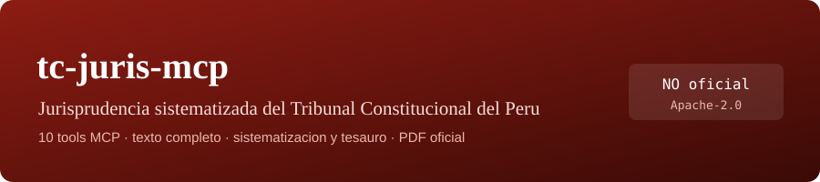

# tc-juris-mcp

[](https://github.com/pipaacebedo/tc-juris-mcp)

**Servidor MCP local para la Sistematizacion Jurisprudencial del Tribunal Constitucional del Peru** —{ruta}→ `https://jurisprudencia.sedetc.gob.pe/sistematizacion-jurisprudencial/busqueda` (API oficial `jurisbackend.sedetc.gob.pe/api`). NO oficial.

## Que hace (10 tools)

| Tool | Title | Uso |
|---|---|---|
| `buscar_sentencias` | Buscando sentencias | TEXTO COMPLETO (Elasticsearch del TC). Normaliza tildes ('pension' matchea, 'Pensión' NO hace match sin normalizar). Comodin `*`. Cap ES: 1000 paginas. |
| `busqueda_avanzada` | Buscando con filtros avanzados | expediente, demandante/demandado, fecha EXACTA o RANGO (`2020-01-01,2020-12-31`), sentido, distrito, sala, tipo, palabras claves (ids). Sin cap practico de paginas (74k+ filas). |
| `resultados_sistematizacion` | Buscando por sistematizacion | si vienen por SISTEMATIZACION tematica del TC (6 ramas: precedentes vinculantes, tipos de proceso...). |
| `resultados_tesauro` | Buscando por tesaurio | si vienen por arbol de conceptos del TESAURO (`sentencias`/`autos`/`interlocutorias`). |
| `detalle_sentencia` | Obteniendo ficha de sentencia | ficha COMPLETA por slug: fundamentos INTEGRALES (la decision; sin truncar) + URL del PDF. |
| `descargar_pdf` | Descargando PDF de sentencia | guarda el PDF publicado por el TC en `~/Downloads` (cap 20 MB configurable, nunca trunca). |
| `listar_filtros` | Listando filtros | tipo (224), distritos (115), salas (5), sentidos (417), tipos de tesaurio (3). |
| `listar_tesauro` | Listando arboles del tesaurio | arbol completo con counts por nodo. |
| `listar_sistematizaciones` | Listando sistematizaciones | arbol completo de la sistematizacion (6 ramas + children). |
| `listar_palabras` | Listando palabras clave | catalogo de 29 603 palabras claves, filtro LOCAL letra/contiene (alimenta `busqueda_avanzada(palabras=)`). |

## Caracteristicas

- **Sin navegador**: solo `httpx` directo a la API del TC (backend Laravel + Elasticsearch). Rapidisimo (respuestas 0.3–1.5 s).
- **Contrato cerrado**: esquema `additionalProperties: false` en TODAS las tools; los errores viajan como `{ok: false, error, pista}` con pista ACCIONABLE.
- **`index` GLOBAL** 0-based continuo entre paginas; 10 filas por pagina (dato del backend).
- **Watchdog** por tool: `TCJ_TOOL_TIMEOUT=300` s (toda tool responde, o error con pista; nunca cuelga).
- **Resolucion id/nombre**: los buses aceptan ids o nombres EXACTOS del catalogo (y si el nombre es ambiguo —'Lima' matchea Lima/Lima Norte/Lima Este/Lima Sur/...— devuelve el error con los ejemplos).
- **Sin truncamiento** de datos (fundamentos completos); PDF con cap declarado (si supera, error con tamaños).
- **Catalogos en cache** 30 min en-process con lock (TTL configurable `TCJ_CACHE_TTL=1800`).
- **Canal de actualizacion**: el server consulta GitHub (`pipaacebedo/tc-juris-mcp`) al arrancar y agrega la linea `UPDATE DISPONIBLE` a sus instrucciones si existe una version mayor (desactivable con `TCJ_UPDATE_CHECK=0`).

## Limites VERIFICADOS del backend del TC (documentados al modelo)

1. **El indice NO matchea acentos** ('pension' si, 'Pensión' no) — el servidor normaliza siempres, por lo tanto la busqueda es SIEMPRE la misma.
2. Buscar 1 palabra/patron mejor ('funcionarios*' → 4822) vs multi-palabra (que puede dar 0 o total capado en `>= 10000`).
3. `search + id_sentencia_distrito` combinados = 0 (BUG del backend, verificado; el `nota` avisa al modelo).
4. El buscador simple cap 1000 paginas; la busqueda avanzada NO tiene ese cap.
5. `fecha_publicacion` acepta exacta o RANGO con COMAS; otros formatos (dd/mm) devuelven 500 del backend.
6. El tesaurio de interlocutorias esta VACIO en el backend (counts 0).

## Instalacion

Con [MCPB](https://github.com/anthropics/mcpb) — descarga `tc-juris-mcp-0.1.3.mcpb` desde [Releases](https://github.com/pipaacebedo/tc-juris-mcp/releases) y arrastralo a tu harness.

Manual: `pip install -e .` y agrega el server stdio en tu harness:

```bash
uv run --directory /ruta/a/tc-juris-mcp-0.1.0.mcpb  server.py
```

## Variables de entorno

| Var | Default | Uso |
|---|---|---|
| `TCJ_BASE` | API oficial | base de la API del TC |
| `TCJ_TIMEOUT` | 60 | timeout HTTP por$peticion |
| `TCJ_TOOL_TIMEOUT` | 300 | watchdog por llamada de tool |
| `TCJ_CACHE_TTL` | 1800 | duracion de cache de catalogos |
| `TCJ_UPDATE_CHECK` | 1 | desactivar chequeo de version con `0` |
| `TCJ_DOWNLOADS` | `~/Downloads` | destino de `descargar_pdf` |
| `TCJ_PDF_CAP_MB` | 20 | cap bytes del PDF (si supera, error con tamano real) |

## Nota legal

Proyecto **NO oficial**, sin afiliacion con el Tribunal Constitucional del Peru ni el Estado. Los datos consumen la fuente publica del TC con fines de consulta; el contenido pertenece al TC publicante. Licencia **Apache-2.0** para el código.

---

### Changelog

#### 0.1.4
- Distrito aislado (estres v3, MAYOR): `busqueda_avanzada` con SOLO `id_sentencia_distrito` devuelve nota de advertencia (el backend del TC puede no aplicar ese filtro aislado: filas de otros distritos); instrucciones (xii).
- Fechas espurias epoch-0: filas con `fecha_sentencia` < 1990 viajan COMPLETAS con flag `fecha_sentencia_sospechosa: true` (dato nunca alterado).
- Catalogo `distritos` espurio upstream + nodos de sistematizacion sin contenido: notas y doc (xiii).

#### 0.1.3
- Frontera de paginacion (F1 estres v2): `page` valida pero fuera del total real (ej page=1000 con 44 paginas) ahora devuelve nota especifica 'page N fuera de rango: hay M paginas' con precedencia sobre las notas genericas de 'sin resultados' (en los 4 buses).
- `listar_filtros` categorias de detalle PAGINADAS (100/pag, `page`/`paginas` cap 3): 'sentidos' completo (~86 KB) ya no viaja de un bote (anti-truncamiento-ciego, F2).
- `listar_tesauro`: documentado el `code` inconsistente del TC (dato upstream; navegar por `id`, F3) + instruccion (xi).

#### 0.1.2
- `listar_tesauro` NAVEGABLE (default raices nivel 1 + `parent_id`/`depth` 1..4): el arbol completo (~146 KB) NUNCA se entrega de un bote (truncamiento ciego del cliente eliminado); campo renombrado `count_subarbol` (acumulado del subarbol del TC, distinto del total directo de `resultados_tesauro` — hallazgo H1 del estres v1).
- Comillas en `buscar_sentencias`: el server las quita (el indice no soporta frases exactas; con comillas el backend va al cap '>= 10000') y devuelve nota.
- Mensajes de desambiguacion muestran TODOS los ids matcheados (cap 12) con conteo consistente.
- Backend verificado v1 de estres (documentado en instrucciones/items iv-x): fecha exacta degrada al anio; expediente parcial por subcadena; palabras multiples = OR; search de sistematizacion solo texto del fallo; fechas espurias 1969-12-31 (epoch 0) en el corpus.

#### 0.1.1
- Watchdog TOTAL: toda la logica de cada tool (resolvers de catalogos incluidos) corre bajo `con_watchdog` (promesa de 300 s verificada ya en el peor caso de red).
- Anti-blind-spot: total 0 en `resultados_sistematizacion`/`resultados_tesauro`/`buscar_sentencias` siempre trae `nota` explicativa (id invalido vs sin datos).
- Nomenclatura: `buscar_sentencias` devuelve `extractos` (fragmentos que matchean; el texto integro es de `detalle_sentencia`); pista especifica ante 404 de ficha.
- Correcciones de texto en las INSTRUCCIONES y removida la frase heredada de sesiones (server stateless).

#### 0.1.0
- Primera construccion end-to-end con el API del TC: 10 tools, catalogos completos, tesauro y sistematizacion, ficha de sentencia con fundamentos completos, PDF por URL/slug, canal de actualizacion oficial.
